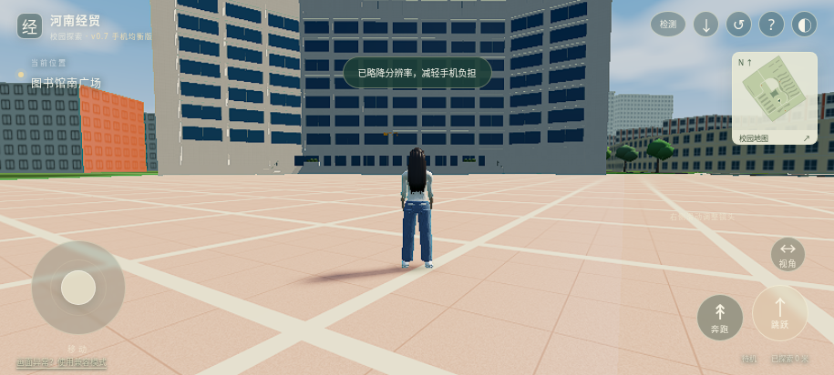

# 河南经贸3D数字校园

当前正式源码、可编辑模型和自动化处理流程集中保存在本仓库。游戏为 PlayCanvas 2 横屏第三人称网页应用，优先使用 WebGPU，不支持时回退 WebGL 2；支持触控、行走、奔跑、跳跃、地图、复位及 PWA 安装入口。

AI 按阶段执行远程获取、验收、提交与推送，后台重试已验证成果；冲突分支保留、未完成编辑不自动提交。机制、范围和恢复方式见 [持续同步](docs/github-sync.md)。

现有体验入口：[河南经贸校园探索](https://henan-jingmao-campus-play.earthyaspen11.chatgpt.site)。该入口已开放公开试玩，无需使用项目所有者账号。GitHub保存源码，网页版沿用原Site；当前上线状态见 [部署记录](reports/web-deployment.json)。

当前源码为 **v0.7 手机均衡版**：默认1.0倍渲染、1024px单级阴影，保留TAA锐化；高清和超清可选。附近精细楼群限制为6处，基础楼体持续可见，手机正常游玩以30FPS为上限目标。此为预算优化，实体安卓流畅度仍待自动报告验证。

新增13张参考照片已核验。19处常规楼体复用原资产，改按每层3.9米规则组织；图书馆九层主体35.1米，1.8米入口基座另计，台阶和人物不随层高拉伸。图书馆补充窗边、花池和扶手，修正弧面构件；实际GLB/FBX重导入和桥面/台阶/水域通行通过。详见 [v0.7验收、前后对比及限制](docs/v07-validation.md)。

国内托管包已准备；国内账户授权和网络实测尚缺，不能保证原网址在大陆可达。百度收录也未完成，见 [国内访问与托管](docs/china-hosting.md)。

首次开始后约45秒自动采样，可跳过、重测和导出本机报告。使用方法见 [手机设备检测](docs/device-check.md)，完成与待办见 [当前工作状态](docs/work-status.md)。




## 当前质量边界

这是可玩的初级校园原型。20处建筑保留地图轮廓；图书馆南广场及5栋同类楼群完成局部外观改进，另外14处仍以基础轮廓为主。长宽采用OSM米制轮廓，层数含估计，3.9米层高为用户规则；这不构成测绘级1:1。另有3处总图可见结构尚未可靠定位，不能宣称完整校园已补齐。人物及水深仍含估算；全景照片没有被当作三维网格或摄影测量成果。

云端实际物理检查通过，已有浏览器运行、横屏触控模拟、安装条件及离线重载记录。实体安卓安装、硬件 WebGPU、真实手机帧率尚未验收；已观察到的云端软件渲染帧率不满足流畅目标。PWA 是目前的软件形式，尚未生成 APK。

## 工程位置

| 目录 | 内容 |
| --- | --- |
| `game/` | 当前游戏源码、锁定依赖、构建产物及原有运行证据 |
| `game/dist/` | 可由 HTTP 服务直接提供的完整网页应用及 GLB |
| `assets/henan_campus/project/` | 可编辑校园 Blender 工程、FBX、纹理、布局及来源数据 |
| `assets/henan_campus/character/` | 可编辑角色、GLB/FBX、MakeHuman 基础资产及许可证 |
| `templates/library_south_plaza.json` | 图书馆成功样板：步骤、参考、参数、验收条件与适用范围 |
| `configs/` | 20 栋建筑清单、共享任务模板与分批任务配置 |
| `automation/` | Python 标准库驱动的 DAG、哈希缓存、导出与质量检查 |
| `reports/` | 本次实测快照、20 栋模型索引及分批结果 |
| `tests/` | 缓存损坏、依赖失败、质量阻断、有限重试及回滚等故障测试 |
| `tools/` | 有限额的公开资料索引、照片批处理及浏览器检测脚本 |

校园 GLB 的正式运行文件为 `game/dist/assets/campus.glb`；FBX 为 `assets/henan_campus/project/HenanCampus.fbx`。不另建第二套正式校园工程。缓存中的逐栋导出仅为检查中间产物，不上传、不代替正式工程。

## 本次已落地的自动化

1. 图书馆作为成功样板，提取可复用的导出与检查方法。立面精修规则只适用于该类建筑，不能直接套到宿舍等建筑。
2. 用同一任务模板和不同建筑编号、附属对象参数处理 20 栋已有模型，不重新建模。
3. 依赖图先检查工具与输入；缺少条件时仅阻断相关下游。异常按环境、输入、完整性、配置、质量五类归并根因。
4. 缓存键包含输入文件哈希、参数、工具版本、平台、驱动代码及依赖输出哈希；命中时再次核对产物，损坏则隔离并由可信输入重建。
5. 先暂存并验收，通过完整批次才更新当前产物指针。失败保留原因；只对超时或暂时占用最多尝试两次。回滚同样要求完整且哈希有效的历史产物。

原复用流程按 **1 → 3 → 6 → 20栋**通过，v0.5楼群构件按 **1 → 3 → 5栋**扩展。历史v0.5完整批次49任务及49缓存复用保留；v0.6只重算受影响资产并重新执行当前门禁，未把旧49缓存记录当作新版验收。当前34项Python测试（包含11项同步与2项闭合台阶测试）、8项实际Rapier移动/水域测试、9项性能判断测试通过。详见 [v0.5批次](reports/v05-full-batch.json)、[缓存复用](reports/v05-cache-reuse.json) 和 [模型索引](reports/model-catalog.json)。这不代表全校外观已完成精修。

## 后续由 AI 在云端执行

当前复用流程使用 Python 3.12、Blender 4.3.2、Node.js 24；游戏依赖由锁文件固定。下列命令供维护本项目的 AI 使用，手机用户无需安装或操作这些工具。

```bash
npm ci --prefix game --no-audit --no-fund
python -m unittest discover -s tests -v
python -m automation.pipeline --campaign pilot --report reports/pilot.json
python -m automation.pipeline --campaign small --report reports/small.json
python -m automation.pipeline --campaign trial --report reports/trial.json
python -m automation.pipeline --campaign all --report reports/full-batch.json
```

重复执行 `all` 会验证并复用缓存；输入或驱动变更后才重新计算受影响任务。只检查浏览器工程可执行：

```bash
python -m automation.pipeline --targets gate.campus gate.avatar gate.physics game.build gate.pwa proof.prior_browser --no-promote --report reports/ci-validation.json
```

本地预览可由 AI 执行 `python -m http.server 8080 --directory game/dist`。实体手机安装需要可访问的 HTTPS 部署；普通 HTTP 地址不具备完整 PWA 安装条件。

GitHub Actions 在每次推送时执行故障测试、实际物理验证、构建和静态网格/PWA 门禁。云端 CI 不宣称已做手机实测或浏览器渲染。更完整的调度、回滚和扩展规则见 [自动化说明](docs/automation.md)。

设备报告判定另有9项JS测试：`npm run check:performance --prefix game`。资源调查按配置执行 `python tools/resource_inventory.py`；图片批处理由AI执行 `python tools/photo_reference_batch.py --campaign pilot`、`small`、`all`，图片解码使用Pillow。原始参考图片只保存在忽略的 `.resource-cache/` 中，仓库记录来源、哈希与观察结论；没有把公开可见等同于可再分发许可。

## 下一项主要工作

先用已缓存的地图与全景地面锚点解决3处缺失结构的定位，再加入可验证轮廓。当前总图配准未通过空间合理性门禁，不能直接批量放置。与此独立，由手机自动报告确定真实GPU预算。已有模型继续复用，同类外观只迁移已验证规则。摄影测量仅在具备合格多位置照片且稀疏重建通过后使用COLMAP；本仓库尚无摄影测量成果，不会对全景切片盲跑。

原始人物参考照片与全景照片未批量上传到这个公开仓库。来源、权利及估算边界见 [资源说明](docs/sources-and-rights.md)，历史实际运行细节见 [游戏验收报告](game/验收报告.md)。
