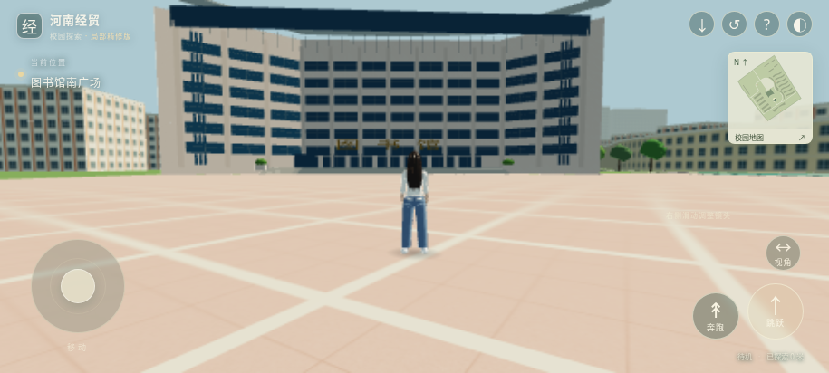

# 河南经贸3D数字校园

当前正式源码、可编辑模型和自动化处理流程集中保存在本仓库。游戏为 PlayCanvas 2 横屏第三人称网页应用，优先使用 WebGPU，不支持时回退 WebGL 2；支持触控、行走、奔跑、跳跃、地图、复位及 PWA 安装入口。

现有体验入口：[河南经贸校园探索](https://henan-jingmao-campus-play.earthyaspen11.chatgpt.site)。该入口目前受托管平台的所有者访问权限限制。GitHub 保存源码，不会自动成为游戏网址；本次未新增公开游戏部署。



## 当前质量边界

这是可玩的初级校园原型。20 处建筑保留地图轮廓；图书馆南广场完成一次照片引导的局部精修，其余 19 处仍为草模。建筑高度、部分用途、垂直结构及人物细节包含估算，不能视为学校原始模型或测绘成果。现有全景照片也没有被当作三维网格或摄影测量成果。

云端实际物理检查通过，已有浏览器运行、横屏触控模拟、安装条件及离线重载记录。实体安卓安装、硬件 WebGPU、真实手机帧率尚未验收；已观察到的云端软件渲染帧率不满足流畅目标。PWA 是目前的软件形式，尚未生成 APK。

## 工程位置

| 目录 | 内容 |
| --- | --- |
| `game/` | 当前游戏源码、锁定依赖、构建产物及原有运行证据 |
| `game/dist/` | 可由 HTTP 服务直接提供的完整网页应用及 GLB |
| `assets/henan_campus/project/` | 可编辑校园 Blender 工程、FBX、纹理、布局及来源数据 |
| `assets/henan_campus/character/` | 可编辑角色、GLB/FBX、MakeHuman 基础资产及许可证 |
| `templates/library_south_plaza.json` | 图书馆成功样板：步骤、参考、参数、验收条件与适用范围 |
| `configs/` | 20 栋建筑清单、共享任务模板与分批任务配置 |
| `automation/` | Python 标准库驱动的 DAG、哈希缓存、导出与质量检查 |
| `reports/` | 本次实测快照、20 栋模型索引及分批结果 |
| `tests/` | 缓存损坏、依赖失败、质量阻断、有限重试及回滚等故障测试 |

校园 GLB 的正式运行文件为 `game/dist/assets/campus.glb`；FBX 为 `assets/henan_campus/project/HenanCampus.fbx`。不另建第二套正式校园工程。缓存中的逐栋导出仅为检查中间产物，不上传、不代替正式工程。

## 本次已落地的自动化

1. 图书馆作为成功样板，提取可复用的导出与检查方法。立面精修规则只适用于该类建筑，不能直接套到宿舍等建筑。
2. 用同一任务模板和不同建筑编号、附属对象参数处理 20 栋已有模型，不重新建模。
3. 依赖图先检查工具与输入；缺少条件时仅阻断相关下游。异常按环境、输入、完整性、配置、质量五类归并根因。
4. 缓存键包含输入文件哈希、参数、工具版本、平台、驱动代码及依赖输出哈希；命中时再次核对产物，损坏则隔离并由可信输入重建。
5. 先暂存并验收，通过完整批次才更新当前产物指针。失败保留原因；只对超时或暂时占用最多尝试两次。回滚同样要求完整且哈希有效的历史产物。

本次按 **1 → 3 → 6 → 20 栋**实际运行通过；完整批次共 49 个任务。再次运行 **49 个任务全部命中缓存，无模型重导出和游戏重编译**。21 项故障及几何测试通过。详细机器记录见 [自动化汇总](reports/automation-summary.json) 和 [模型索引](reports/model-catalog.json)。这证明批量复用与检查有效，不代表 20 栋已完成外观精修。

## 后续由 AI 在云端执行

当前复用流程使用 Python 3.12、Blender 4.3.2、Node.js 24；游戏依赖由锁文件固定。下列命令供维护本项目的 AI 使用，手机用户无需安装或操作这些工具。

```bash
npm ci --prefix game --no-audit --no-fund
python -m unittest discover -s tests -v
python -m automation.pipeline --campaign pilot --report reports/pilot.json
python -m automation.pipeline --campaign small --report reports/small.json
python -m automation.pipeline --campaign trial --report reports/trial.json
python -m automation.pipeline --campaign all --report reports/full-batch.json
```

重复执行 `all` 会验证并复用缓存；输入或驱动变更后才重新计算受影响任务。只检查浏览器工程可执行：

```bash
python -m automation.pipeline --targets gate.campus gate.avatar gate.physics game.build gate.pwa proof.prior_browser --no-promote --report reports/ci-validation.json
```

本地预览可由 AI 执行 `python -m http.server 8080 --directory game/dist`。实体手机安装需要可访问的 HTTPS 部署；普通 HTTP 地址不具备完整 PWA 安装条件。

GitHub Actions 在每次推送时执行故障测试、实际物理验证、构建和静态网格/PWA 门禁。云端 CI 不宣称已做手机实测或浏览器渲染。更完整的调度、回滚和扩展规则见 [自动化说明](docs/automation.md)。

## 下一项主要工作

按可见影响优先处理主要道路沿线建筑的外观与比例。已有模型直接复用；每种外观先做一栋并比对照片，再扩大到同类建筑。没有可靠尺寸时保留估算标记。摄影测量仅在具备合格多位置照片且稀疏重建验证通过后使用 COLMAP；本仓库尚未实现或验收自动摄影测量重建，不会对全景切片盲目运行。

原始人物参考照片与全景照片未批量上传到这个公开仓库。来源、权利及估算边界见 [资源说明](docs/sources-and-rights.md)，历史实际运行细节见 [游戏验收报告](game/验收报告.md)。
