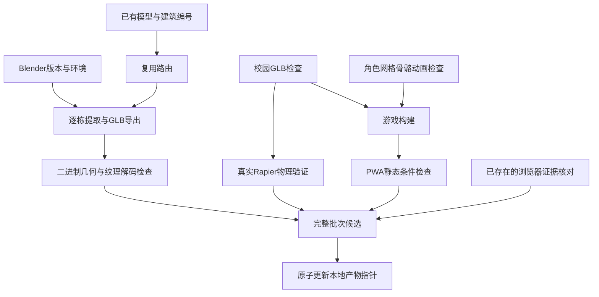

# 自动化处理与验收

本流程采用 Python 标准库和已安装工具的命令行，不依赖生成式 AI 在线调用完成每一栋重复导出。游戏视觉表现仍须用实际渲染与参考图比对判断。

## 依赖结构



网页发布与 Git 推送不由流水线自动执行。当前 `active.json` 是本地缓存产物指针，不会偷偷替换在线游戏，也不会改写源 Blender 工程或 `game/dist/`。游戏构建输出先保存在缓存中。

## 输入、模板和分批

`configs/pipeline.json` 的 `task_templates.reuse_building` 定义一次公共流程；`batches.items` 只填写建筑编号和明确附属物。参数保持整数、数组等类型，不执行 shell 模板。清单会预先拒绝未知参数、重复任务、依赖缺失、循环和越界输入路径。

样板配方位于 `templates/library_south_plaza.json`。它记录既有图书馆精修方法；当前真正批量运行的是已有模型的提取、导出及验证。历史 Blender 精修脚本保留在 `assets/henan_campus/tools/`，仍有图书馆专用规则，不是任意建筑的通用生成器。涉及照片的配方不在未提供参考图时自动重跑。

| 阶段 | 建筑数量 | 行为 |
| --- | ---: | --- |
| pilot | 1 | 图书馆 13，验证公共导出方法 |
| small | 3 | 13、01、02，检查模板适配 |
| trial | 6 | 再加入 05、06、15 |
| all | 20 | 全部已有建筑及游戏门禁，共 49 个任务 |

小批次成功也不能覆盖完整版本，包括通过回滚命令绕过这一限制。生产候选必须包含配置中的所有 `release_targets`。

## 缓存和资源下载

缓存位于 `.campus-cache/objects/<sha256>/`，键包含输入字节哈希、参数、工具版本/平台、驱动代码和依赖产物哈希。依赖的无关标注改变但输出不变时，下游仍可复用。命中后核对每个输出的长度和 SHA-256；失效内容进入 `quarantine/`，不作为成功复用。

新增公开下载必须声明 HTTPS 来源、允许域名、已知 SHA-256、大小上限和权利信息。优先查本地副本，校验匹配后跳过网络。跟随跳转仍检查域名，401/403 记录为访问限制，不绕过认证。本次 MakeHuman 基础网格使用本地已校验副本，没有重新下载。

## 路由边界

- 有已支持的模型：优先复用。Blender 实际加载和网格导出是后续验证，文件头本身不构成成功证明。
- 无模型但存在照片文件、匹配哈希、不同拍摄位置及重叠标注：最多记为 `RECONSTRUCTION_CANDIDATE`，自动重建关闭；还需图片解码、相机/投影适配和 COLMAP 稀疏配准实测。
- 仅有一处全景切出的多张图、仅有拍摄位置名称或照片不足：`NEED_DATA`，不启动重建。

COLMAP 和 OpenDroneMap 尚未接入本自动化驱动，不标记为完成。现有 20 栋来自已保存的可编辑草模，不是本轮新取得的学校原始模型。

## 五类根因和修复范围

| 分类 | 处理 |
| --- | --- |
| ENVIRONMENT | 一次修复缺失工具、依赖或算力；超时/暂时占用最多尝试两次 |
| INPUT | 补足合法有效输入；不凭空补成成功 |
| INTEGRITY | 隔离哈希损坏、源文件执行中变化或损坏模型，恢复可信副本 |
| CONFIGURATION | 修正任务参数、路径、循环或错误引用 |
| QUALITY | 保留原版本，停止同组批量扩散，先修一例并验证 |

下游阻断归并到原始失败任务，不把同一工具缺失重复报成几十个独立故障。独立任务继续运行。同一组出现质量或完整性错误立即停止扩散。失败日志留在隔离目录；不无限重试、不降低门禁、不执行下载来的未知脚本。

运行与回滚有互斥锁。异常遗留锁必须核查对应进程后清理，不能直接覆盖正在使用的锁。可回滚到经过哈希复查的完整成功批次：

```bash
python -m automation.pipeline --rollback <完整成功批次的run_id>
```

## 验收的实际含义

GLB 门禁读取二进制 POSITION 与索引，不相信扩展名或 JSON 自报包围盒；检查有限坐标、三角形索引范围、有效三维尺寸、纹理数据存在和角色四段动画。Blender 导出额外检查源建筑主体封闭与图片可解码。通用 GLB 门禁只识别内嵌图片签名，不替代完整 glTF 验证器或渲染。

物理门禁实际执行 Rapier 模拟，包含行走、奔跑、跳跃、台阶、碰墙、出生点及跌落恢复。构建门禁实际执行 esbuild。PWA 门禁检查横屏独立窗口配置、图标真实尺寸及必需文件。

`proof.prior_browser` 只校对原有浏览器验收文件并标为历史证据，不当作本轮新运行浏览器或安卓实测。仓库中的分批报告是本机实测快照，缓存绝对路径只用于追踪，其他环境会自行重建缓存。完整正式校园/人物文件都已直接纳入仓库。

21 项测试覆盖故障注入、缓存污染、工具变更、依赖阻断、有限重试、源输入变化、回滚完整性及伪造包围盒等。故障测试使用最小夹具；真实 20 栋导出与游戏物理检查另有实际执行记录。当前流程不自动判断照片相似度、真实建筑尺寸或手机流畅程度。
