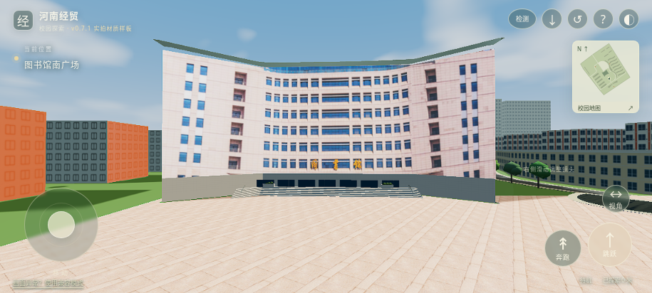
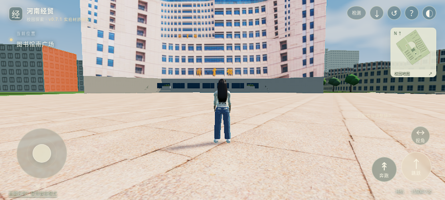

# v0.7.1 实拍材质样板

图书馆上部正立面的三段墙面及南广场铺装已适配到现有可自由行走的三维场景。正式模型仍是同一份 HenanCampus.blend，附带 GLB、FBX；没有新增另一套校园工程。

## 实际同机位对比

以下均是实际网页渲染：同一915×412视口、1.25倍渲染、相同镜头与朝向，关闭SSAO/Bloom。新图保留照片中的长短窗带、墙色和题字；图书馆的侧后面、入口和屋顶仍是原估算模型，周围楼栋没有在本轮变成实拍还原。

修改前：

修改后：

比较图使用可选高清档，不代表手机默认负担。默认均衡档实际画面：

## 复用的方法与资源

- 原VR的54个拍摄站、324张立方方向图全部复用缓存，本轮没有重跑54站网络分析，也没有重新下载这些原图。方向图不是324个独立摄影测量机位，更不是324栋建筑。
- 已确认的图书馆南广场站为 `scene_ef8a1b1d35eefd7f`，来源 https://www.ivrpano.com/p/2b89e1f8b87d40ad ，日期记录为2017-08-11，不能代表学校当前全部外观。
- 先用用户照片提取窗户构件做小样，发现重复窗格仍保留错误的长短窗关系，最终选择整段墙面透视校正，再投影到已有三维墙面的方法。配置见 `configs/photo-projection-library.json`；墙面四角为参数化标定，未声称测绘精度。
- 先中央一段、再两段、最后三段。只截取墙体，避开天空和前景；地面从同站向下方向图提取石材铺装。正式衍生纹理共592658字节，原全景和私有校正预览不进公开仓库。
- 立面照片含拍摄时光照，因此GLB使用标准 `KHR_materials_unlit`，不把原照片再当作全新PBR材质受光。FBX用图片基础色保留纹理，其渲染器不保证与GLB的unlit显示相同。
- 删除冲突的旧正面装饰窗格；模型三角形从108317减至103645，减少4672（约4.31%）。已有54组物理来源网格及碰撞数据逐项保持一致，其余19个分区模型保持原字节内容。
- 默认立面最长边512px、远景256px；高清1024px/512px，保留手机原有1.0倍默认渲染和1024阴影预算。近景卸载时切换到带照片的粗模，离线也有粗模可见。

## 已通过的门禁

| 项目 | 证据及范围 |
| --- | --- |
| 资源真实性 | `reports/panorama-photo-pool.json` 与 `photo-projection-materials.json`，输入和衍生输出SHA-256、解码与尺寸 |
| 实际三维网格 | `photo-projection-gates.json`、`photo-projection-geometry.json`，完整校园、分区与粗模GLB有效 |
| GLB/FBX重导入 | `photo-projection-reimport.json`，20处索引、闭合主体、纹理解码、1毫米坐标容差 |
| 物理未受损 | `photo-projection-physical.json`，物理来源网格逐项对照；实际Rapier通行检查通过 |
| 实际网页 | `photo-projection-browser.json`，Chromium软件WebGL2实际运行，触控移动9.10米、贴图预算、近远切换、检测结束恢复设置、离线粗模重载、同源请求、无JS运行错误 |
| 当前版本对应 | 浏览器记录输入哈希，部署包核对当前输入与资源清单；其余19区与已验收基线逐字节核对 |

没有用云端软件渲染帧率冒充实体安卓性能，也没有再次运行未改变的45秒检测逻辑来宣称新手机数据。之前完整v0.7报告继续保留其原输入哈希；当前变化部分以本轮报告为准。

## 尚未通过的整体验收

现有体量、平面轮廓和照片角点仍有估算；3.9米规则保留，图书馆主体35.1米，但照片窗带与实际楼层一一对应尚未验证。照片不包含可恢复的完整深度；这不是COLMAP重建，也没有取得学校原始三维模型。入口立面、背面、屋顶、窗洞真实进深以及全校其他楼栋逐栋匹配仍未完成。实拍材质有固定历史光照，不能替代可变光照的完整实测PBR模型。

源照片许可未独立核实，公开可访问不代表CC0；用户已请求将其衍生为游戏纹理，原图不再分发，项目不统一声明所有素材可商用。中国大陆可达性、实体安卓GPU/FPS/温升和耗电仍未实测；本轮运行截图只证明云端实际软件WebGL2运行。

下一步只选一栋有明确身份、可分离墙面和足够像素的楼继续验证。批量流程自动复用缓存；建筑身份、遮挡、比例或贴图质量不合格即停止该栋，不能把样板无条件复制到全校。
