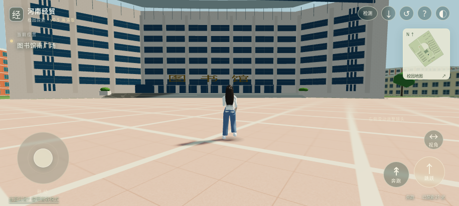
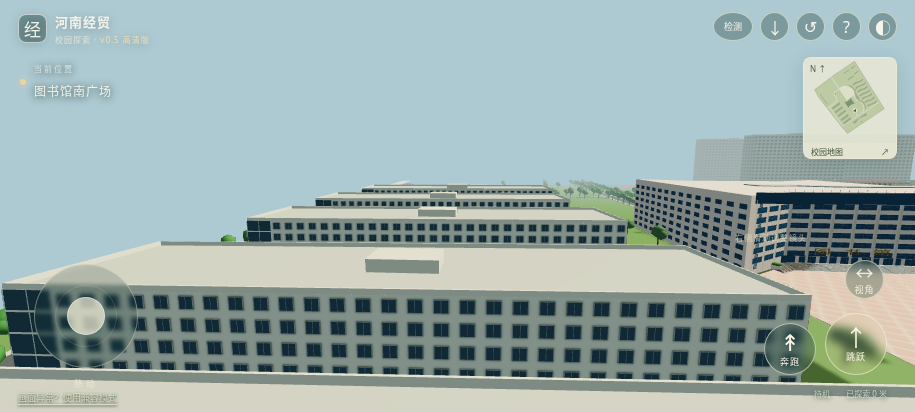
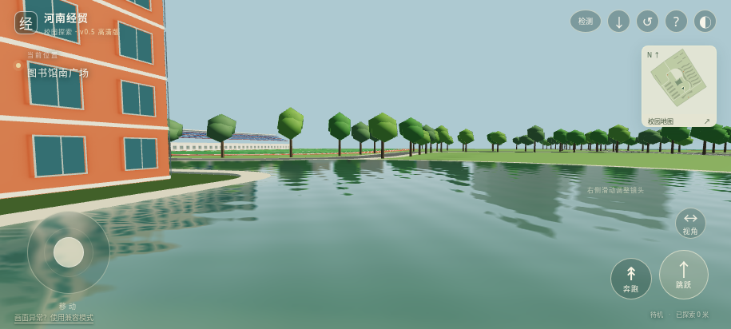

# v0.5 验收范围

本轮修复移动卡顿、实现用户要求5倍漫游、统一3米层高，扩展5栋楼群构件及高清光影水景。实际运行截图：

截图来自Chromium软件WebGL2的真实三维运行，不是效果图，不代表安卓硬件性能。

- 45项自动测试：32项Python（管线/几何/同步）、4项实际Rapier移动、9项性能判定。另有7个管线门禁及GLB/FBX实际重导入检查。
- reports/v05-browser.json：触屏尺寸运行、5倍移动与Run动画、烘焙AO材质、1024px实时阴影、SSAO/Bloom实际开启、3处岸距深度图及12面Cubemap捕获通过。
- reports/v05-physics.json：行走、奔跑、跳跃、楼体碰撞、4处出生点、掉落恢复和台阶检查。
- reports/playable-regression.json：移动、触控、镜头、地图、重置与离线重载。
- reports/v05-full-batch.json 与 v05-cache-reuse.json：49任务通过及49缓存复用。
- reports/v05-building-coverage.json 与 v05-map-registration.json：明确记录3处未接入结构及配准失败，不作完成结论。

米制单位不等于测绘准确。楼层数有估计、每层3米是用户规则；水深由距岸线估算；5栋楼群是照片类别引导近似。脚步改进不能把13.25/26.5m/s称为真人自然步速。14处其他建筑、全校覆盖、逐栋身份和真实手机GPU预算尚未完成。

本版重新运行完整45秒设备检测、JSON导出、取消、旋屏中断及本机报告恢复，均通过功能检查；软件WebGL2约0.9–1.1FPS，性能未达标，报告没有判为硬件WebGPU通过。见 reports/browser-device-check.json。
