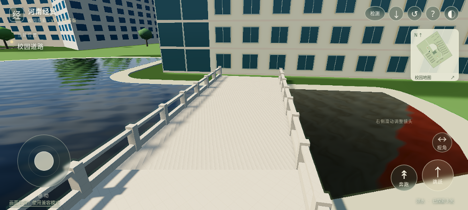
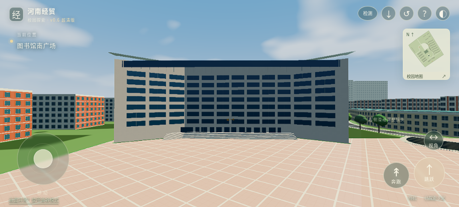
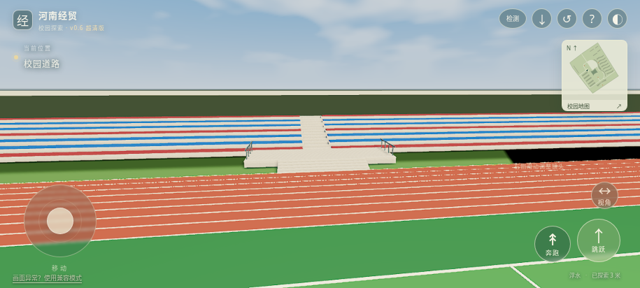
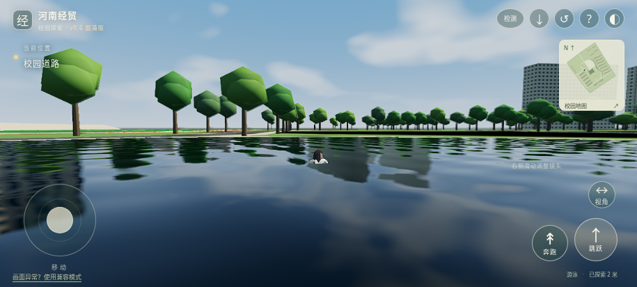

# v0.6 验收与剩余限制

继续使用同一工程、同一网页入口：https://henan-jingmao-campus-play.earthyaspen11.chatgpt.site 。访问权限保持所有者可用。上线状态以 reports/web-deployment.json 为准。

## 本轮修复

| 项目 | 实现及证据 |
| --- | --- |
| 桥 | 复用石桥全景缓存，增加石质开孔栏杆、桥面及两端过渡；实际过桥和栏杆碰撞检查。位置与20×7米尺寸仍为估计 |
| 图书馆层高 | 公开采购文件明确涉及九层，湖景资料亦描述九层。楼面按每层3米，九层主体27米；入口基座1.8米单独计，楼层网格从入口平台1.96米标高起算。并非实测总高 |
| 台阶 | 照片引导重做12级入口台阶，单级0.15米、踏步0.38米，总升高1.8米。实际不跳跃登阶检查通过；尺寸仍是估计，室内尚未开放 |
| 体育场平台 | 增加中央观礼平台、5级接地台阶和护栏；看台修复旧座椅浮空，中央细分通道可步行登高。移除内部重合面，GLB/FBX闭合检查通过 |
| 下水 | 去除原水域阻挡；地面/道路挖空，生成岸距估算湖床，加入浅水涉水、水平身体体积近似的浮力和阻力、游泳/浮水动作与接触波纹。支持返回岸上；不属于完整流体求解 |
| 人物 | 复用1.701米基础网格和原4段动作，新增Swim/Tread；衣物细节法线、牛仔裤/头发/皮肤粗糙度调整。脸部和头发仍为参考近似 |
| 超采样与阴影 | 绘图缓冲真实按1.25–1.5倍设置，独立于设备像素比；2048px、2级CSM、PCF5，PCSS可选；局部实时阴影与静态地面阴影结合 |
| TAA | 邻域历史颜色夹取、运动自适应混合、切镜/缩放历史重置、人物屏幕区域与水面反应区域，适度0.22锐化。未宣称完全消除所有闪烁或拖影 |
| PBR与贴图 | 自制4096px原始石材色彩/粗糙度/法线；运行时1K/2K预算，部分高精细节采用无损WebP传输。原有未精修建筑仍保留基础贴图 |
| HDR及后处理 | 自制RGBA16F天空、IBL、半分辨率SSAO、HDR Bloom、轻微色彩分级、可选低步数体积雾。不是学校实拍HDR全景 |
| 水面渲染 | 双层多尺度法线、屏幕空间折射、岸泡与接触波纹、HDR局部Cubemap；12面初始化，附近逐面动态刷新，帧耗时超预算暂停。初始捕获超时可补齐，不冒充平面反射 |
| 加载与LOD | 20个楼群细节分区；190米内加载，250米外卸载；基础地图实体保持显示，失败/离线用基础实体。按预算收缩贴图并释放远处分区 |

## 实际证据

- reports/v06-reference-audit.json：缓存来源、九层资料链接、哪些尺寸仍估计；没有重新下载54个全景站。
- reports/v06-geometry.json、v06-character.json：几何参数与人物尺度。
- reports/v06-interactions.json、v06-physics.json：真实Rapier下水、过桥、台阶、平台、看台通道与普通移动碰撞。
- assets/henan_campus/project/verification/reimport_validation.json：GLB/FBX重新导入、20处建筑索引、闭合主体、纹理解码与不超过1毫米的导出一致性。
- reports/v06-ao-bake.json：真实2048px Cycles AO，16采样；4096px静态投影源图。没有将放大旧图算作新烘焙。
- reports/v06-browser.json：实际Chromium软件WebGL2，超采样缓冲、HDR/TAA、两级阴影、游泳、反射、可选效果与分区卸载；以报告内源哈希确定验证版本。
- reports/playable-regression.json：电脑和横屏触控、地图/复位/镜头、竖屏保护及离线重载。

## 尚未完成

1. 全校测绘级1:1：平面采用OSM，层数除图书馆线索外仍含估计。桥位、湖岸/水深、台阶及平台尺寸都没有测量依据。
2. 总图另外3处结构仍未可靠定位；其余14处建筑外观与逐栋身份尚未精修，不宣称完整校园。
3. 图书馆等建筑室内尚未开放；本轮台阶为入口外部台阶。
4. 安卓实体设备WebGPU、帧率、温升、安装与持续离线行为。云端软件WebGL2运行不能代表手机性能。
5. GPU纹理块压缩（如KTX2/Basis）、高精平面反射、全场景间接光烘焙及照片级人物尚未实现或验收。WebP是文件传输压缩，不等于GPU压缩。
6. “极致清晰、稳定、性能”是优化目标；尚无手机硬件数据，不能保证所有设备都无锯齿、无拖影且流畅。

最后一行诊断恢复补丁由当前源哈希的完整设备检测回归单独验证。其他渲染代码和模型哈希与原渲染验收一致；原报告保留当时哈希，增量对应见 reports/v06-incremental-validation.json。首次真实点击自动检测与跳过亦通过；仅取消等待并不存在的页面导航，保留原生点击。
