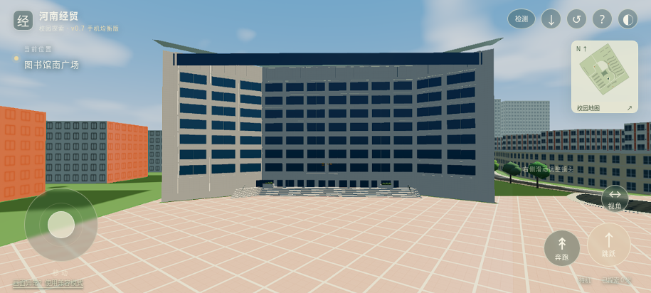

# v0.7：手机均衡配置与照片参考整改

本轮使用同一仓库、同一正式 Blender 工程与原公开 Site。未新增 APK、Unreal 工程或第二套校园。

## 已完成及证据

| 项目 | v0.6 默认 | v0.7 默认 |
| --- | --- | --- |
| CSS 尺寸对应的渲染比例 | 1.5 | 1.0；持续低帧时可降至0.85 |
| 阴影 | 2048、2级CSM、PCF5 | 1024、1级CSM、PCF3 |
| 手机正常游玩帧率上限目标 | 随显示调度 | 30；检测时单独采样 |
| SSAO / Bloom / 体积雾 / PCSS | 部分默认开启 | 默认关闭，高清档或设置中可选 |
| 水面 | 折射、局部动态刷新 | 多尺度波纹、泡沫、初次捕获反射保留；折射/动态刷新留给高档 |
| 精细分区 | 190米内加载 | 140米加载、195米卸载、最多6处；基础楼体一直保留 |
| 常规楼层 | 3米规则 | 3.9米规则 |

相同视口下默认渲染像素数量减少约55.6%，阴影图配置的像素面积减少75%。这些是可核算的工作预算变化，不是手机实测FPS提升或显存测量。高清1.25和超清1.5仍可选择；TAA、锐化、HDR天空和基础PBR保留。

13张新照片完成ZIP CRC、实际解码、格式、尺寸、SHA-256检查，原图只保存在忽略的缓存中。图书馆身份可由标识及外形确认；其余未定位照片用于类型观察。没有把稀疏照片、截图作为已完成摄影测量。

先验证图书馆，再验证图书馆/一栋宿舍/一栋教学楼，最后应用到19处常规楼体。全部复用已有轮廓、网格与立面资产，按3.9米规则调整，图书馆九层主体35.1米。入口门仍为2.1米；台阶、护栏、看台阶梯、人物及桥没有统一拉伸。图书馆按照片补充窗边实体厚度、花池、灌木和扶手；宿舍共用既有立面图集增加空调格栅类型细节，未声称每张照片已对应楼号。

新场景108317三角形，较前版增加约1.98%。同机位检查发现的弧面直梁突出，已改为沿真实模型折线分段的构件。GLB、FBX实际重新导入：20处索引齐全、主体闭合、图片解码通过、导出坐标差异小于1毫米。此处验证的是格式、网格与单位一致性，不是学校实测精度。

实际Rapier运行通过桥面、体育场平台/看台、水域及图书馆入口平台。新增入口路线实际达到约1.985米脚底高度；平台几何顶面为1.96米，差值来自控制器接触间隙。

## 实际画面对照

前后使用相同网页相机 `[35,13,85] → [-25,14,0]`、915×412视口与1.25绘图缓冲。最终形态对照暂停人物输入，暂时隐藏设置对话框的呈现，保持分辨率固定；没有修改建筑像素或合成学校照片。参考照片缺少相机标定，不能称为与实拍严格同角度的重投影验收。

前版：

当前：

当前默认手机预算下的实际游戏：

完整实际浏览器记录为 `reports/v07-browser.json`：默认画布/阴影/纹理预算、触控移动、镜头、地点信息、地图、45秒采样与报告导出、设置恢复、离线重载均通过。最终只修改图书馆分区及场景来源哈希，增量复验为 `reports/v07-visual-revalidation.json`；它核验旧证据与当前输入哈希、实际加载GLB的哈希，以及新模型的实际显示。没有修改旧报告的输入哈希来伪造通过。

## 三道验收的边界

1. 正确性：本轮层高规则、单位、网格、物理通行及导入导出通过。平面尺寸和大量楼层数仍含估算，不能标为真实校园测绘级1:1。
2. 精致度：已修正已确认图书馆的局部参考特征与弧面构件缺陷。多数建筑尚未有逐栋实拍对应，完整校园和人物仍不是照片级还原；未定位亭子没有被放到猜测坐标。
3. 综合质量：模型增量受控，实际浏览器确认较低预算已生效，且触控/缓存可用。云端软件WebGL2采样明确报告数据不足、硬件WebGPU未通过；实体安卓FPS、温升、电量仍未验收。

因此本项目属于“局部实现通过、完整真实性与手机硬件综合验收待完成”，没有将三道总体验收全部标为合格。本轮批量应用的是不增加拓扑的层高映射和已有资产复用，未批量扩散未经定位的新建筑或高成本效果。

## 国内访问与下一步

已实际验证浏览器所有HTTP游戏资源请求来自同一站点，无海外CDN运行依赖。可部署到授权的国内HTTPS静态托管；打包脚本校验当前浏览器证据及全量资源哈希，生成同一版本的部署ZIP。

当前缺少国内托管账户/域名授权；GitHub Pages开通接口返回403。原Site保持公开，但中国大陆连通性未实测，百度搜索收录未完成。详情与最小部署条件见 [国内访问与托管](china-hosting.md)。

最有价值的下一步是获得可部署的国内HTTPS目标，由AI上传当前22MB左右的静态包并验证大陆访问；同时让手机自动报告决定是否还要调低预算。无需用户建模、编程或安装开发工具。
